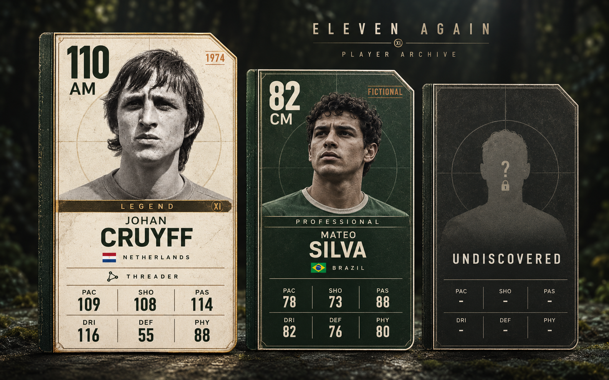

# Eleven Again — player archive card direction

27 October 2026. Visual concept and future implementation guide. No gameplay code or active task status is changed by this delivery.

## Recommendation

Design the reusable card system now while match implementation continues. Establish its information hierarchy, portrait treatment, states, and small-size behaviour before producing a large roster. The user supplied a FIFA-like gold card as a reference for the required information, not as an instruction to copy its frame.

The proposed identity is **a football player's place in a personal archive**: a clipped corner, narrow album-binding spine, a restrained pitch-circle motif, a prominent photographic portrait, and an era stamp. These repeated details connect historical football to a collection that survives individual runs.

The current example shows a Legend, a fictional Professional, and an undiscovered index entry. The warm ivory/brass Legend complements the existing forest/ivory match direction. Ordinary cards remain attractive and readable; they should not look like discarded junk.

The image is an art-direction reference, with staged materials and perspective-like presentation. Production cards should be flat native UI, the same dimensions and aspect ratio at a given display size, with subtle rather than heavily weathered textures. Do not reproduce the board's background, different card sizes, lighting, or perspective as part of every card.

## 1. Card anatomy

Use a consistent **5:7 width-to-height ratio**. Suggested authoring reference: 600×840. Use native text and data fields; the screenshot's exact generated proportions are not authoritative.

| Zone | Information | Reason |
|---|---|---|
| Upper left | Large primary-position OVR, smaller position | Fast sorting and comparison |
| Upper right | Historical year/version stamp, or Fictional | Makes different versions understandable |
| Upper 55–60% | Head/shoulders cutout, quiet pitch motif | Recognisable player identity |
| Narrow divider | Strength-band name with a pattern/material cue | Tier recognition beyond colour |
| Identity | Given name and stronger surname/full display name | Quick scan with complete identity |
| Country | Small flag and country text | National identity without dependence on flags alone |
| Optional row | One signature trait name and icon | Makes a tactical specialist identifiable |
| Lower area | Six attributes in a stable 2×3 layout | Comparable information in every card |

The sample prints PAC/SHO/PAS on the first row and DRI/DEF/PHY on the second. Keep that order everywhere. Values up to 120 need three-digit space, including tabular numerals and enough horizontal padding.

The current GDD uses AM; the concept therefore says AM rather than CAM. If user-facing position terminology changes later, map it consistently rather than accidentally creating another gameplay role.

Avoid licensed club badges, sponsor logos, decorative trophies, crowns, and filigree. The era and country supply more relevant context for an all-time invitational squad. National flags should be separate verified assets or simple geometric equivalents, not extracted from another game's card.

## 2. Proposed visual grammar

- Forest background: approximately `#101E1A`.
- Main dark card face: approximately `#18352A`.
- Warm paper: approximately `#EFE9D9`.
- Dark text: approximately `#17251E`.
- Brass accent: approximately `#B99A58`.
- Era-stamp accent: approximately `#B86E35`.
- Muted secondary text: adjust against the actual surface for readable contrast.

These are design starting points, not sampled/validated final colour tokens. Test them in Godot, including focus rings and disabled states.

Use a clear condensed face for OVR/surname only if a licensed font is selected. Use a readable sans serif for names, positions, labels, and tooltips. Native text must remain sharp when cards scale. Texture should never run through attribute digits strongly enough to reduce contrast.

### Strength-band treatments

Retain the GDD's bands and thresholds unless the user changes them. Appearance is a proposed skin, not a balance change:

| Band | OVR | Material treatment |
|---|---:|---|
| Foundation | 1–64 | Quiet warm gray paper, charcoal rule |
| Prospect | 65–74 | Muted sage/forest, plain edge |
| Professional | 75–84 | Deep forest, ivory type, simple binding |
| Star | 85–94 | Stronger forest contrast and a bronze corner accent |
| Icon | 95–104 | Ivory face, cool dark-metal edge |
| Legend | 105–114 | Archival ivory, restrained brass edge and band |
| Apex | 115–120 | Deep charcoal, pale-metal edge, distinct fine engraving |

Keep one basic shape. Distinguish tier using its printed band name and edge pattern as well as colour. An expensive-looking card does not add a hidden performance bonus. Fame, portrait age, discovery status, and current squad ownership are not additional strength tiers.

## 3. The two example cards

These values are authored for this concept. They are **not official EA/FIFA ratings**, and they are not established player-balance decisions.

| Field | Johan Cruyff | Mateo Silva |
|---|---|---|
| Identity | Real player, 1974 concept version | Fictional demonstration character |
| Role | AM | CM |
| Country | Netherlands | Brazil |
| Band | Legend | Professional |
| PAC | 109 | 78 |
| SHO | 108 | 73 |
| PAS | 114 | 88 |
| DRI | 116 | 82 |
| DEF | 55 | 76 |
| PHY | 88 | 80 |
| Displayed OVR | 110 | 82 |
| Signature trait | Threader | None in this example |

Using the current GDD's weights, Cruyff's AM total is 109.9, rounded to 110; Silva's CM total is 81.7, rounded to 82. Those calculations were checked. They establish internal arithmetic consistency, not historical accuracy or gameplay balance.

Threader is an existing proposed GDD trait: +3 PAS for ground passes originating in the attacking half. Show the short name on an expanded card and the complete rule on inspection. Do not alter the printed base PAS when the trait is merely conditionally available.

Goalkeepers need a role-aware inspection variant showing REF/HAN/POS/DIV/KIC as already proposed in the GDD. Do not pretend the outfield six-stat layout is sufficient to judge keeping. Keep a consistent overall card silhouette; choose the exact compact goalkeeper summary when goalkeeper resources are implemented.

## 4. Portrait production workflow

The user's proposed process is appropriate technically: source a photograph → crop → remove background → place the transparent subject into the card. The source photograph's reuse permission must be checked separately. Cropping/removing a background does not supply missing permission.

### Sourcing

1. Search for a suitable photograph, using Google as a discovery tool if convenient.
2. Open its original source/file page. Record the photographer, date, source URL, licence, and required credit.
3. Confirm that the licence permits the intended reuse and modification; not every Creative Commons licence permits adaptations.
4. Prefer sources with clear licensing, such as archive releases and individually checked Wikimedia Commons files. Commons is not one universal licence.
5. Choose an image appropriate to the card's named era. Do not use a modern retirement portrait for a 1974 playing version without labelling that deliberate choice.

For this example, `source/cruyff-1974-original.jpg` comes from [File:Cruyff1974.jpg on Wikimedia Commons](https://commons.wikimedia.org/wiki/File:Cruyff1974.jpg), which explicitly lists **CC0 1.0**, photographer **Bert Verhoeff / Anefo**, and **26 May 1974**. Detailed source information is in `SOURCES.md`. This file-specific copyright status is not a blanket clearance for every player likeness, kit mark, or future publication.

Google's own [image-use guidance](https://support.google.com/websearch/answer/29508?hl=en-GB) recommends checking the host's licence details. Do not scrape portraits from completed EA cards or treat Google thumbnails as the original source.

### Preparing the portrait

1. Preserve the original downloaded image and source record.
2. Crop with the entire hair/head, neck, and enough shoulders to avoid an awkward floating face. Leave headroom.
3. Remove the background into genuine alpha transparency. Fine hair edges deserve inspection on both light and dark test surfaces.
4. Preserve recognisable identity and photographic character. An AI-assisted cutout is an edited derivative, not a guarantee that original pixels and every facial detail are unchanged.
5. If exact photographic fidelity is required, make/refine a conventional mask from the original rather than treating generative output as a pixel-perfect extraction.
6. Keep the original image treatment where possible. Black-and-white historical photos may remain black-and-white; modern portraits may remain colour. Shared framing and subtle grading unify the cards.
7. Export a portrait-only RGBA PNG, then keep it separate from the frame. The supplied cutout is an example asset, not a completed imported Godot resource.

`cruyff-1974-cutout.png` was made using built-in image generation with transparency requested. File inspection confirmed a 32-bit ARGB PNG, dimensions 1194×1317, and alpha 0 at both top corners. This confirms actual transparent samples, not perfect matting of every hair or full identity fidelity.

For future assets, start with a portrait near or above 1024px tall when the source supports it. Render with a per-portrait scale and anchor so differing photo crops do not change the position of labels. Do not stretch a face to fit a fixed box.

## 5. Card states and interaction

### Recruitment candidate

The five candidates are fully visible even before discovery. The user must be able to compare a known offer. Hover or focus shows a restrained outline/lift and may expand trait information. Clicking selects a candidate; it does not instantly spend money, release a player, or close the other choices.

Put the Confirm recruit action outside the card. If the squad is full, display the replacement comparison before commitment. A clear selected state uses an outline plus checkmark, not colour alone. Keyboard arrows move between cards; Enter selects; Escape backs out according to the current offer flow.

### Market candidate

Use the same card face. Price and Buy belong in a purchase strip below/outside it. Funds, affordability, purchase limits, and replacement consequences belong to the screen, not permanently stamped over a portrait. An unaffordable card remains inspectable with a clearly disabled purchase action and a reason.

### Owned squad player

Use the same card face with small contextual outside-card cues for starting XI, reserve, suspension, and selected role. Permanent card OVR stays tied to its authored primary role; role-adjusted OVR and its penalty belong in lineup comparison. Runtime fatigue does not rewrite collectible base attributes.

### Discovered index entry

Full identity and attributes remain visible even after the run ends, but ownership is separate. A discovered card is not necessarily currently recruited. Do not show a permanent Owned badge because it was recruited in a previous run.

### Undiscovered index entry

Use an anonymous silhouette, a neutral dark finish, and hidden/dashed fields. No name, portrait outline specific to that person, nation, year, OVR, role, tier colour, trait, or identifying tooltip should leak the player. Do not use price/padlock presentation that implies payment is required.

Discovery occurs after successful recruitment/purchase under the proposed GDD rules. Viewing an opponent, hovering a market card, or declining a candidate does not discover it. Offer visibility is temporary decision information; permanent index discovery is a separate state.

## 6. Size and implementation guidance

Build one reusable native Godot card component. Split its portrait, frame/material, texts, trait row, attribute grid, interaction state, and contextual purchase strip. Do not generate and import one entire pre-rendered card per player.

Suggested authored fields: person ID, card/version ID, name, country, era/year or fictional label, primary/familiar positions, base attributes, optional keeper attributes, strength band, optional trait ID, portrait reference, portrait anchor/scale, and source-credit record. OVR is computed/validated from the rating model; collection state and current-run ownership are separate data.

Use the existing project architecture when the card task begins; this guide does not require new modules, resource formats, dependencies, or a class hierarchy today. Native Controls/containers and a small number of reusable frame/texture assets are sufficient. Keep static material effects very light and avoid a shader per UI element.

### Responsive variants

- **Expanded detail:** full portrait, identity, six stats, and trait rule in the adjacent inspector. Around 300×420 or larger.
- **Recruitment:** around 224×314 at a 1280×720 baseline, with five comparable cards across the available width. Protect name/rating/position/stats readability. Show a trait icon/name on focus or adjacent detail if the full text is too small.
- **Compact squad/index:** portrait, name, OVR, position, and relevant state; stats open on inspection. Do not shrink six numbers to illegibility simply to keep the full layout.

At a given variant all cards have equal size, irrespective of rarity. The hero enlargement in the concept sheet is presentation emphasis only. Three-digit attributes, long surnames, missing portraits, and goalkeeper details need explicit layout checks.

Use initials/an authored neutral silhouette when a discovered player's image is missing. A missing portrait is not the same thing as an undiscovered player: known identity and valid gameplay data must remain available.

## 7. Review and verification

### Completed for this concept

- Visually reviewed the supplied reference, downloaded source, transparent portrait output, and three-card concept.
- Checked the original file SHA-1 against the Commons record: `f149a2e9ee9d7eed40df58fcb1b1a26090277aa1`.
- Checked actual PNG alpha samples and pixel format on the cutout.
- Checked both example OVR calculations against the current GDD.
- Preserved active implementation files; this delivery adds design references only.

### Checks for later implementation

- [ ] Cards remain readable at 1280×720 and 1920×1080, including five-offer layout and increased UI scale.
- [ ] Text/attributes come from data and remain sharp; every value up to 120 fits.
- [ ] Portraits have no obvious matte halo on ivory or forest surfaces; face and labels do not collide.
- [ ] All cards use consistent proportions, baseline and information order.
- [ ] Hover, keyboard focus, selected, disabled purchase, and replacement/cancel states work.
- [ ] Index anonymity does not leak through tooltip/accessibility labels or rarity decoration.
- [ ] Index discovery and current squad ownership remain distinct.
- [ ] Each portrait has a valid source record; missing images use a functional fallback.
- [ ] No unnecessary later-stage gameplay is added just to reproduce the concept.

No Godot card implementation, runtime interaction, font contrast test, or gameplay balance test was performed for this concept-only delivery. The generative board is not a verified UI screenshot or a frame asset pack.

## Copy-and-send request for the implementing Codex

> When the card/recruitment task is reached, use `outputs/card-design-reference-v1/player-card-concept.png` for the proposed archive-card style and this handoff for behaviour. Use a reusable native Godot card with separate portrait, frame, text, attribute grid and state. Preserve GDD role/OVR rules and separate permanent discovery from current ownership. Keep five candidates comparable and readable at 720p, support keyboard focus, and inspect the real UI at both target resolutions. Use checked portrait sources and the supplied Cruyff source/cutout only as an initial example. The concept's ratings and styling are reviewable proposals, not permission to rebalance gameplay or abandon the current milestone.
