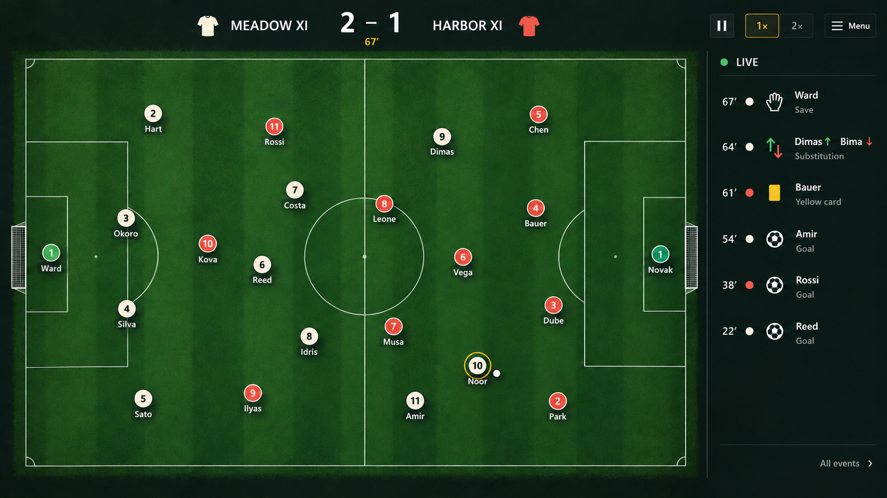

# Eleven Again — match UI visual target

27 October 2026. A concept and UX handoff requested by the user. This is a proposed finished visual target, not a claim that the current project implements these screens or features.



## The requested change

Make watching the football feel like the finished game. The existing screenshot reads as a development control panel: title, exhibition labels, kickoff/restart/quit commands, redundant section captions, statistics, instructions, and prototype disclaimers compete with the pitch.

The user wants a focused match screen, a compact scoreboard, pause and speed controls, and a menu for secondary actions. The full pitch and circle players remain central. This request is for a visual reference and explanation to give the implementing Codex; it does not request changes to the running project.

## Visual direction

A crafted football tactics board with broadcast-style clarity. Rich dark green turf, subtle alternating mowing stripes, fine chalk lines, quiet near-black forest panels, warm ivory and muted coral tokens, and restrained amber selection. Keep the pitch orthographic and fully visible. Use detail and spacing to improve finish rather than adding dashboard widgets or decorative text.

The image is a composition/material reference. Build the actual HUD with native Godot Controls and render the real simulation on the pitch. Do not ship the screenshot as a flat substitute for functioning UI. Recreate geometry, text, icons, and player positions from game data.

## Persistent layout

1. **Scoreboard above the pitch:** team names and small kit/team identifiers around a strong score, with a compact match clock. Centre it on the pitch area rather than the whole window.
2. **Pitch:** the largest element, nearly filling the available height below the header. All touchlines, both goals, and all 22 players fit without scrolling or cropping.
3. **Right-side event column:** a small Live heading and recent events. Use compact minute, team cue, icon, actor, and event type. One or two lines per event; no story paragraphs and no large heading.
4. **Top-right controls:** pause/resume icon, a 1×/2× segmented speed selector, and a Menu button. Use a clearly visible selected-speed state and keyboard focus.
5. **No persistent bottom panel:** let the pitch use the space. Player inspection appears only when requested. Basic help belongs in settings or contextual tooltips.

Keep the original match information hierarchy: ball and immediate contest → team shape → score/clock → major events → optional detail.

## What leaves the live HUD

- Game title/logo and Exhibition / Match Lab labels.
- The Match, 4–3–3, Fictional squads, Match Journal, and introductory story copy.
- Kickoff, Restart, and Quit buttons from the persistent toolbar.
- Always-visible Shots, On target, and Passes totals, bars, or tracks.
- Phase/test disclaimers and always-visible keyboard instruction footers.

This information can remain useful elsewhere. Formation belongs in preparation, statistics in Match details, and limitations in development documentation. Removing a statistic from the default layout does not remove its authoritative tracking.

## Control and state behaviour

### Entering the match

The eventual flow is Squad preparation → one Start match action → match presentation → live play. The live match has no second kickoff command. A short opening transition can show the teams before play starts, but must not require a redundant toolbar click.

While the project is an exhibition prototype, a boot-time opening transition or a simple temporary pre-match state may still be needed. Keep prototype reset/start tools behind the menu or a deliberate debug control. Do not add recruitment, preparation, or run systems just to implement this visual target.

### Pause and speed

Space and the pause button toggle pause. The icon changes to resume/play when paused. The 1×/2× selector keeps the selected value obvious; pausing does not change it. Controls remain available with keyboard focus, and focus never consumes a gameplay command accidentally.

Pause freezes the simulation. Speed changes advance the same authoritative simulation consistently; they do not change event probabilities, RNG, or results. No new tactical changes are introduced during play.

### Menu

Clicking Menu or pressing Escape pauses play and opens a small, clear modal over a dimmed, still-readable match. Remember whether play was running before opening it. Trap keyboard focus in the modal and restore it to the triggering control when dismissed.

Proposed menu:

```text
Paused

Resume match
Match details
Settings
Restart exhibition       [exhibition mode only]
Return to main menu
Quit to desktop
```

Only show actions supported by the current implementation. Avoid inert buttons for future features. Do not put restart/quit back onto the live toolbar as a shortcut.

Escape dismisses the menu and restores the previous running/paused state. Choosing Resume match explicitly starts playback. Opening/closing nested Match details or Settings keeps the match paused until the menu is closed or Resume is chosen.

Restart exhibition requests confirmation because it discards the current exhibition. In a future roguelike run, it must not become a free attempt reroll: replace it with an explicitly destructive Abandon run action according to run rules. Return/quit must follow the actually implemented save/resume contract; never imply progress is saved when it is not.

### Events and statistics

Default event rows prioritise goals, saves, interceptions/tackles, fouls/cards, and substitutions. Avoid printing every routine pass into the small column. A quiet All events action opens a scrollable full log while paused. Match details contains shots/on-target/pass totals and other implemented statistics.

The image shows six illustrative events consistent with a 2–1 score: Reed and Amir score for Meadow, Rossi for Harbor. It includes a save, card, and substitution to demonstrate the finished visual vocabulary. In the current phase, show only events the engine actually produces; do not fabricate cards or substitutions to imitate the picture.

All displayed scores, actors, timestamps, substitutions, and statistics must come from the existing authoritative state/events. Newest events sit at the top. Updating the feed must not steal focus or scroll the pitch.

### Player inspection

Hover or keyboard/mouse selection can reveal a compact player detail panel. A surnamed, numbered marker remains readable without opening it. Inspection must not obstruct a live chance; selecting a player must not grant direct control or alter tactics.

## Geometry and typography guidance

The generated image is approximately 16:9 and has minor optical differences from exact game geometry. Use these implementation rules over literal pixel tracing:

- Preserve a true 105:68 playable field aspect ratio, fitting it inside the available pitch region.
- Start with a roughly 78:22 pitch/event split; adapt the event width for legibility at each resolution.
- At 1920×1080, use approximately 32px outer margins, a 90–110px header region, and a roughly 300–340px event column. Let the field fit the remaining rectangle without stretching.
- At 1280×720, use tighter 16–24px margins and an approximately 240–270px event column. Show fewer recent events rather than shrinking type excessively.
- Keep ordinary interface text around 16–18px at the 720p baseline, with appropriately larger scoreboard numbers. UI scaling is independent of field simulation coordinates.
- Use stable-width/tabular score and clock numerals, generous row spacing, and consistent left alignment in the feed.
- Minimum usable pointer target: about 40px at the 720p baseline. Icons need accessible names/tooltips and keyboard equivalents.

Pitch texture is subtle and optional. A light reusable turf texture and alternating field bands are sufficient; expensive grass simulation, stadium art, strong vignettes, bloom, or decorative particles are unnecessary.

## Marker and ball details

- Exactly eleven players per side, including the keeper. The selected image was corrected to include missing away player Kova.
- Outfield discs use warm ivory versus coral. Also distinguish teams using outline/pattern so colour is not the only cue.
- Goalkeepers may have alternate fills, as in the image, but should retain a clear team-colour ring or team cue in the implementation.
- Use consistent shirt numbers and short surnames below tokens. Prefer a restrained text halo over heavy rectangular name boxes.
- Avoid label collisions and marker occlusion. Prioritise ball carrier and selected-player labels when space is tight.
- One crisp ball with a dark outline. A thin possession ring supports it; the ball remains distinguishable from a player token.
- No passing targets, shot trajectories, debug arrows, bounding boxes, or developer gizmos in the ordinary view. Keep diagnostic overlays explicitly opt-in during development.

## Handoff acceptance checklist

- [ ] Screenshot at both 1280×720 and 1920×1080 with the entire field and goals visible.
- [ ] HUD contains only team/score/clock, pause, speed, Menu, and the concise event column.
- [ ] No title, kickoff/restart/quit toolbar, static formation caption, prototype footer, or persistent statistics table.
- [ ] Menu supports mouse, keyboard, visible focus, Escape, and correct pause restoration.
- [ ] Pause and 1×/2× work without changing supported-build match outcomes.
- [ ] Player names, numbers, team cues, selected-speed state, and ball are legible during motion and at increased UI scale.
- [ ] Score and feed agree; no future-feature events are fabricated.
- [ ] Secondary information is reachable on demand, and destructive actions are clearly separated.
- [ ] Existing simulation, tests, and unrelated ongoing work remain preserved.

## Copy-and-send implementation request

> Use `outputs/match-ui-reference-v1/match-live-concept.png` as the finished visual target and follow `MATCH_UI_HANDOFF.md` for interaction behaviour. Refine the existing match HUD within the current phase: pitch first, compact team/score/clock above it, concise live events on the right, and pause/1×/2×/Menu at the upper right. Move restart/quit and secondary details into a real pause menu, move match entry out of the live toolbar, remove redundant headings/debug captions and persistent statistics. Preserve the authoritative simulation and current work. Implement native Godot UI rather than displaying the concept as a background. Verify real output at 720p and 1080p and test the changed controls. Do not expand into later gameplay systems simply to populate the mockup.

## Delivery and verification limits

The built-in image-generation tool produced the concept; the selected result was visually inspected for hierarchy, readable labels, player count, controls, and score/event consistency. Generation prompts are in `GENERATION_PROMPTS.md`.

This delivery adds reference files only. It does not modify the active match code, task status, theme, or runtime behaviour. No Godot import, interaction, performance, or automated gameplay check was run for this reference-only request. These checks belong to the later implementation.
