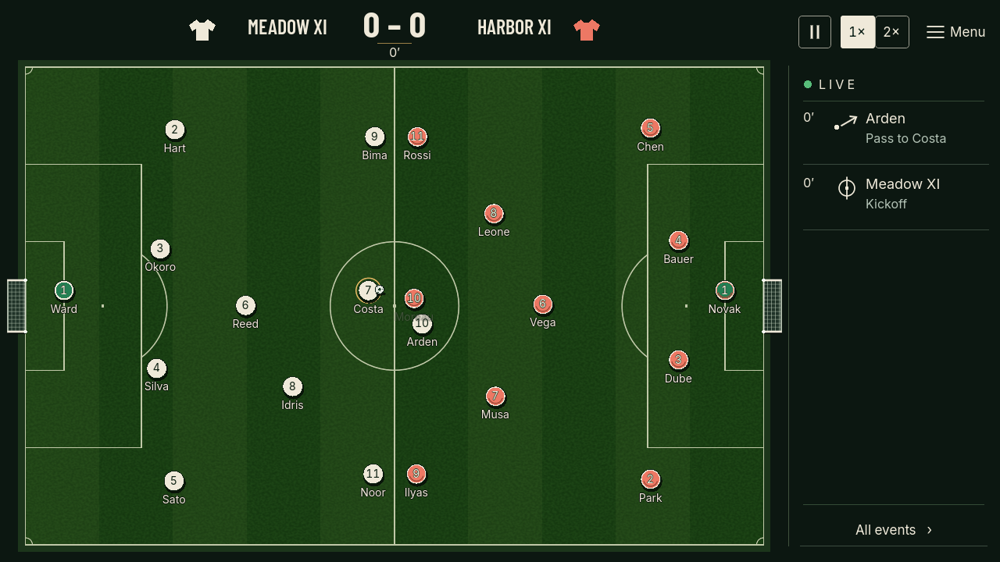
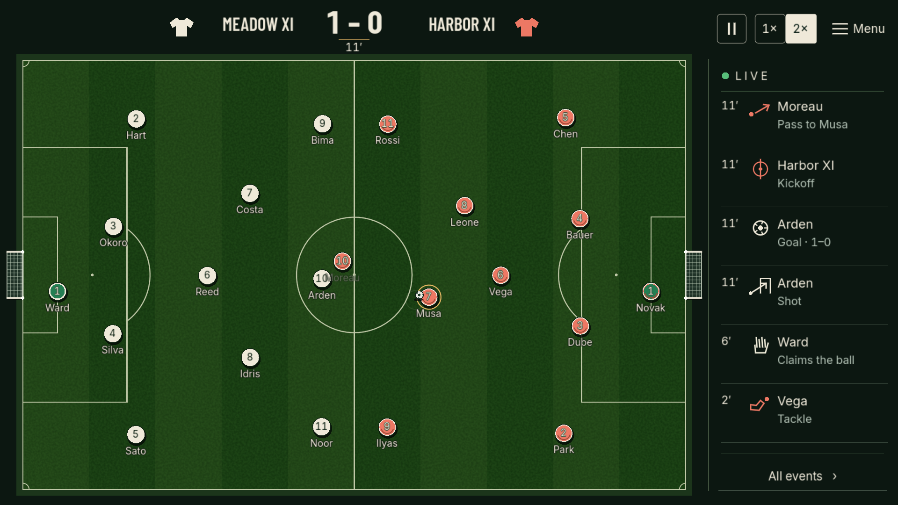

# Proper kickoffs — task 1.13

28 October 2026. Godot 4.7.2.stable.official.ed1daf0bf, GL Compatibility. Local branch `codex/proper-kickoffs`.

First-half, post-goal and second-half kickoffs share one setup: stationary unowned centre ball, players in their own halves, opponents at least 9.15 metres away, and a 12-tick countdown. The final countdown tick launches a real short pass to a midfielder using the existing passing accuracy, travel and reception rules. Only then does active regulation resume. Three active minutes, fixed simulation tick and independent gameplay RNG remain unchanged.

The taker cannot recover or chase their own opening pass before another player touches it. That restriction is cleared on another touch or restart and included in the determinism signature. This prevents the automated players committing the offence; it does not yet implement indirect-free-kick sanctions. The exhibition still chooses the same starting team and one authored backward opening pattern. Editable takers and broader opening choices belong to preparation/AI tasks. A backward kick is a choice, not a law restriction: [IFAB Law 8](https://www.theifab.com/laws/latest/the-start-and-restart-of-play/), checked 28 October 2026.

`kickoff_setup` resets presentation before the kick; `kickoff` and `pass` describe the actual launch. The full event log labels setup honestly. Existing UI direction and short reset reveal are retained.

## Verification

Commands used with `D:\Godot\Godot_v4.7.2-stable_win64_console.exe`:

- `--headless --path . --editor --import --quit`: clean final import/parse, no script errors.
- `--headless --path . --script res://tests/run_tests.gd`: **111,192 assertions, zero failures**. Includes initial/post-goal/second-half placement, stationary setup without action RNG/active time, physical first reception, direct and loose-ball second-touch prevention, eligible pursuit, reset, pause, duplicate Continue, and exact full-state/event equality for presented 1×/2× and headless play. Assertion count includes per-tick invariants, not independent feature tests.
- Native GL `--path . --script res://tests/capture_match.gd --fixed-fps 60 -- --motion=kickoff`, `--motion=goal2x --motion-1080p`, and `--motion=halftime`: each completed 70 saved frames at 20 fps. Inspected sequential frames for initial stationary ball → real pass/recovery, goal → legal kickoff → continuing play, and dispatched Continue → changed ends → second-half pass. Raw sequences stay in ignored `.godot/presentation-frames/kickoff-720/`, `goal2x-1080/`, and `halftime-720/`. Representative stills below are copied from those final sequences. This is sampled native motion review, not a new human watchability or balance acceptance.

| Seed | Score | Shots | Completed passes | Simulated elapsed seconds, including stoppages |
|---|---|---|---|---|
| 11027 | 2–3 | 4–11 | 36–29 | 199.4 |
| 42 | 5–1 | 11–7 | 34–31 | 202.9 |
| 7 | 2–1 | 8–7 | 31–32 | 196.4 |
| 2026 | 2–4 | 6–8 | 35–32 | 201.3 |

Scores differ from the older checkpoint because a real opening action and legal shape change play and RNG consumption. Equality across viewing speeds remains required and passes. These four fixtures do not establish balance.

Next: task 1.14, earliest whole-ball boundary classification and genuine throw-ins/corners/goal kicks. Generic boundary restarts, fouls, full attributes, coordinated AI, tactics and traits are still pending. No push, merge, exported build or wider gameplay claim.
